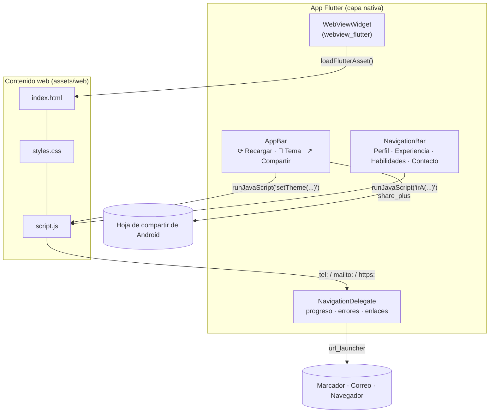
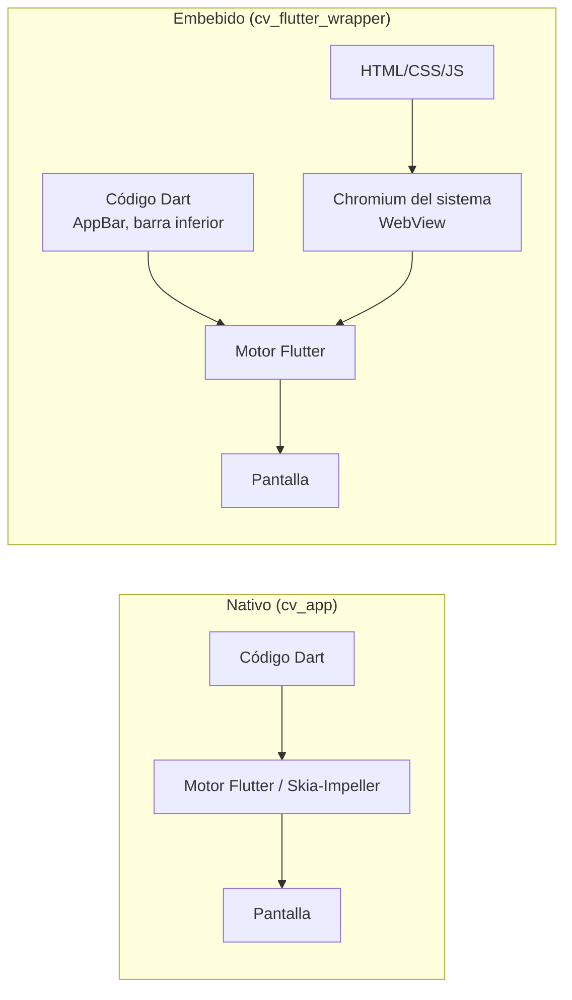

# Práctica: CV Web + Contenedor Híbrido en Flutter

**Universidad Politécnica Estatal del Carchi — Carrera de Computación**
**Asignatura:** Desarrollo de Aplicaciones Móviles · **Docente:** PhD. Samuel Lascano Rivera
**Tema:** Integración Web-Mobile y Contenedores Híbridos
**Estudiante:** John Michael Paredes López
**Fecha:** octubre 2026

---

## 0. Qué pide la práctica (resumen)

| Fase | Entregable | Dónde está en este repo |
|---|---|---|
| 1. CV web | HTML5 semántico + CSS3 responsivo (Mobile-First) + JS interactivo | `web_cv/` |
| 2. Contenedor Flutter | Proyecto `cv_flutter_wrapper` con WebView y controles nativos | `cv_flutter_wrapper/` |
| Resultados | Repositorio Git + informe con capturas y cuadro comparativo | este `README.md` |

Rúbrica a cubrir: **Diseño y adaptabilidad web**, **Integración en Flutter** y **Análisis comparativo**. Cada sección de este documento indica qué criterio cumple.

---

## 1. Estructura del repositorio

```
cv-hibrido/
├── README.md                     ← este informe
├── capturas/                     ← tus capturas de pantalla (sección 6)
├── web_cv/                       ← FASE 1: código fuente web
│   ├── index.html
│   ├── styles.css
│   ├── script.js
│   └── foto.jpeg
└── cv_flutter_wrapper/           ← FASE 2: proyecto Flutter
    ├── pubspec.yaml
    ├── assets/web/               ← copia de web_cv/ (carga offline)
    ├── android/app/src/main/AndroidManifest.xml
    └── lib/
        ├── main.dart             ← tema claro/oscuro global
        └── screens/
            └── cv_web_screen.dart ← WebView + AppBar + barra inferior
```

### Arquitectura del contenedor híbrido



---

## 2. Fase 1 — CV Web (criterio: *Diseño y adaptabilidad web*)

### 2.1 HTML5 semántico

| Etiqueta | Uso en el CV |
|---|---|
| `<header>` | Foto, nombre, cargo y botones de contacto rápido |
| `<nav>` | Menú de botones que lleva a cada sección |
| `<main>` + `<section>` | Perfil, Experiencia, Proyectos, Formación, Habilidades, Idiomas, Contacto |
| `<article>` | Cada experiencia, proyecto y título académico |
| `<footer>` | Derechos y enlace "volver arriba" |

Se mantienen las mismas etapas que la app nativa anterior, así la comparación es justa.

### 2.2 CSS3 Mobile-First

- Los estilos base están pensados para **celular**. Las media queries `min-width: 640px` y `960px` solo **agregan** columnas en pantallas más grandes.
- **Flexbox** para la cabecera, los botones y los chips. **Grid** para la rejilla de proyectos (1 → 2 → 3 columnas).
- Menú *sticky* con desplazamiento horizontal, para que los botones de sección siempre estén a mano.
- Botones de al menos 44 px de alto, como recomienda la guía de accesibilidad táctil. Los campos del formulario usan `font-size: 16px` para que el celular no haga zoom automático.
- Variables CSS (`--fondo`, `--texto`...) permiten el **tema oscuro**, que se activa con `data-theme="dark"` (desde Flutter) o con la preferencia del sistema.

### 2.3 Interactividad con JavaScript

| Interacción | Cómo funciona |
|---|---|
| Desplegables | La experiencia muestra u oculta los detalles al tocarla (`aria-expanded` para accesibilidad) |
| Filtro de habilidades | Chips *Todas / Desarrollo / Datos / Sistemas / Otros* ocultan las habilidades que no coinciden |
| Validación de formulario | Nombre ≥ 3 letras, correo con formato válido y mensaje ≥ 10 caracteres. Si todo es válido, abre la app de correo con el mensaje armado |
| Menú activo | `IntersectionObserver` resalta el botón de la sección visible |
| Puente con Flutter | `window.setTheme('dark')` y `window.irA('contacto')`, que la app llama desde los botones nativos |

### 2.4 Probar la web

Haz doble clic en `web_cv/index.html` para abrirla en Chrome. Luego pulsa **F12 → icono de celular (Ctrl+Shift+M)** y prueba en tamaño *Pixel 7* y *iPhone SE*. Verifica que no haya scroll horizontal y que funcionen el desplegable, el filtro y el formulario.

---

## 3. Fase 2 — Contenedor Flutter (criterio: *Integración en Flutter*)

### 3.1 Crear el proyecto (con Docker, igual que la práctica anterior)

En **PowerShell**:

```powershell
cd D:\hoja_de_vida_App
docker start -ai flutter-cv-maick
```

Si borraste el contenedor, créalo de nuevo con
`docker run -it --name flutter-cv-maick -v "${PWD}:/app" -w /app ghcr.io/cirruslabs/flutter:stable bash`.

Ya **dentro del contenedor**:

```bash
cd /app
flutter create --org com.jeyempar --platforms android cv_flutter_wrapper
```

Después copia sobre el proyecto creado (reemplazando) los archivos de este repositorio: `pubspec.yaml` y la carpeta `lib/`. Luego copia la web a los assets:

```bash
cd /app/cv_flutter_wrapper
mkdir -p assets/web
cp /app/cv-hibrido/web_cv/* assets/web/      # ajusta la ruta a donde tengas web_cv
ls assets/web                                # debe mostrar index.html styles.css script.js foto.jpeg
```

> **Ojo con la foto:** debe llamarse exactamente `foto.jpeg`. Revisa con `ls` (en la práctica anterior el error fue `foto.jpg` / `foto.jpe`).

### 3.2 Dependencias (`pubspec.yaml`)

| Paquete | Para qué |
|---|---|
| `webview_flutter` | Paquete oficial del equipo Flutter para mostrar contenido web |
| `url_launcher` | Abrir `tel:`, `mailto:` y enlaces externos con apps nativas |
| `share_plus` | Botón nativo de compartir perfil |

```yaml
flutter:
  assets:
    - assets/web/      # incluye todos los archivos de esa carpeta
```

### 3.3 Opción de carga elegida: **A (archivos locales / assets)**

```dart
_controller.loadFlutterAsset('assets/web/index.html');
```

Se eligió la Opción A porque la app **funciona sin internet**, no depende de un servidor y encaja con la compilación en Docker. El código ya deja preparada la **Opción B**: basta con cambiar `usarRemoto = true` y poner la URL de GitHub Pages en `urlRemota`.

> Si publicas la web (Opción B), tu teléfono y los de tus referencias quedan públicos en internet. Considera quitarlos de la versión publicada.

### 3.4 Controles nativos implementados

| Control | Ubicación | Implementación |
|---|---|---|
| ⟳ Recargar | AppBar | `_controller.reload()` |
| 🌙/☀️ Tema claro/oscuro | AppBar | Cambia `ThemeMode` de Flutter **y** llama `setTheme()` en la web, así ambas capas cambian juntas |
| ↗ Compartir perfil | AppBar | `SharePlus.instance.share(...)` abre la hoja de compartir de Android |
| Barra de secciones | NavigationBar inferior | Cada botón llama `irA('id')` en la web y desplaza la página |
| Barra de progreso | Debajo del AppBar | `onProgress` del `NavigationDelegate` |
| Pantalla de error + Reintentar | Cuerpo | `onWebResourceError` (útil sobre todo con la Opción B) |
| Botón atrás de Android | Sistema | `PopScope`: retrocede en la web y, si no hay historial, sale |

### 3.5 Manejo de enlaces (detalle importante)

Un WebView **no sabe abrir** `tel:` ni `mailto:`. Si se deja así, muestra `net::ERR_UNKNOWN_URL_SCHEME`. Por eso `onNavigationRequest` deja navegar solo los archivos del CV y envía el resto a `url_launcher`:

```dart
if (esInterno) return NavigationDecision.navigate;
launchUrl(uri, mode: LaunchMode.externalApplication);
return NavigationDecision.prevent;
```

### 3.6 AndroidManifest.xml

En `android/app/src/main/AndroidManifest.xml`:

1. Arriba, dentro de `<manifest>` (antes de `<application>`):

```xml
<uses-permission android:name="android.permission.INTERNET" />
<queries>
    <intent><action android:name="android.intent.action.DIAL" /><data android:scheme="tel" /></intent>
    <intent><action android:name="android.intent.action.SENDTO" /><data android:scheme="mailto" /></intent>
    <intent><action android:name="android.intent.action.VIEW" /><data android:scheme="https" /></intent>
</queries>
```

`INTERNET` solo es obligatorio para la Opción B en *release*, pero no estorba en la Opción A.

2. Cambia `android:label="cv_flutter_wrapper"` por `android:label="CV Híbrido"`.

### 3.7 Compilar e instalar

Dentro del contenedor:

```bash
flutter pub get
flutter analyze
flutter build apk --release
```

En PowerShell, con el emulador encendido:

```powershell
$adb = "$env:LOCALAPPDATA\Android\Sdk\platform-tools\adb.exe"
& $adb install -r "D:\hoja_de_vida_App\cv_flutter_wrapper\build\app\outputs\flutter-apk\app-release.apk"
```

El paquete es `com.jeyempar.cv_flutter_wrapper`, distinto al de la app anterior, así que **no** habrá conflicto con `cv_app` y puedes tener las dos instaladas para compararlas.

### 3.8 Lista de verificación funcional

- [ ] La web carga sin internet (activa el modo avión en el emulador)
- [ ] Recargar funciona
- [ ] El tema oscuro cambia el AppBar **y** el contenido web
- [ ] Compartir abre la hoja nativa
- [ ] Los botones de la barra inferior llevan a cada sección
- [ ] Llamar y Correo abren el marcador y la app de correo (no aparece ERR_UNKNOWN_URL_SCHEME)
- [ ] El formulario muestra errores y, si los datos son válidos, abre el correo
- [ ] El botón atrás de Android sale de la app sin errores

---

## 4. Análisis comparativo (criterio: *Análisis comparativo*)

### 4.1 Cómo medir (para llenar la tabla con datos reales)

Compara **las dos apps en modo release** en el mismo emulador. Compila también `cv_app` con `flutter build apk --release`.

```powershell
$adb = "$env:LOCALAPPDATA\Android\Sdk\platform-tools\adb.exe"

# Tamaño del APK
Get-Item D:\hoja_de_vida_App\cv_app\build\app\outputs\flutter-apk\app-release.apk | Select Name, @{n='MB';e={[math]::Round($_.Length/1MB,1)}}
Get-Item D:\hoja_de_vida_App\cv_flutter_wrapper\build\app\outputs\flutter-apk\app-release.apk | Select Name, @{n='MB';e={[math]::Round($_.Length/1MB,1)}}

# Tiempo de arranque en frío (repite 3 veces y promedia "TotalTime")
& $adb shell am force-stop com.jeyempar.cv_app
& $adb shell am start -W -n com.jeyempar.cv_app/.MainActivity
& $adb shell am force-stop com.jeyempar.cv_flutter_wrapper
& $adb shell am start -W -n com.jeyempar.cv_flutter_wrapper/.MainActivity

# Memoria RAM usada (abre la app primero; mira la línea TOTAL PSS)
& $adb shell dumpsys meminfo com.jeyempar.cv_app | Select-String "TOTAL PSS"
& $adb shell dumpsys meminfo com.jeyempar.cv_flutter_wrapper | Select-String "TOTAL PSS"
```

Para la fluidez, activa en el emulador *Opciones de desarrollador → Representación GPU de perfil → En pantalla como barras* y haz scroll en ambas apps.

### 4.2 Cuadro comparativo

> Reemplaza los `___` con tus mediciones. La columna "Esperado" describe el comportamiento típico, para apoyar la redacción.

| Aspecto | Nativo (`cv_app`, widgets Flutter) | Embebido (`cv_flutter_wrapper`, WebView) | Esperado / Explicación técnica |
|---|---|---|---|
| Tamaño APK (release) | ___ MB | ___ MB | Similar. El WebView usa el motor Chromium **del sistema**, que no se empaqueta |
| Arranque en frío (TotalTime) | ___ ms | ___ ms | El embebido suele tardar más: además de iniciar Flutter, debe iniciar el WebView y luego parsear HTML/CSS/JS |
| Memoria RAM (TOTAL PSS) | ___ MB | ___ MB | El embebido consume más: se suman el motor Flutter y el proceso de renderizado de Chromium |
| Fluidez del scroll | ___ | ___ | El nativo dibuja directo con el motor de Flutter. El WebView es fluido para contenido estático, pero puede notarse en animaciones complejas |
| Aspecto visual | Material 3 en todo | Diseño web propio dentro de un marco nativo | El embebido puede verse "menos nativo" (selección de texto, rebote del scroll, fuentes) |
| Funciona sin internet | Sí | Sí (Opción A) / No (Opción B) | La Opción A empaqueta los archivos |
| Acceso a funciones del teléfono | Directo (plugins) | Indirecto: hace falta un puente (`NavigationDelegate`, `runJavaScript`) | Cada función nativa en el embebido requiere código extra en Flutter |
| Reutilización del código | Solo la app | La misma web sirve para navegador, Android, iOS y escritorio | Ventaja principal del híbrido |
| Actualizar contenido | Recompilar y reinstalar el APK | Opción B: se actualiza la web sin tocar la app | Con la Opción A también hay que recompilar |
| Mantenibilidad | Un solo lenguaje (Dart) | Dos tecnologías (Dart + HTML/CSS/JS) y un puente entre ellas | Más piezas, pero la parte web la puede mantener un perfil web |
| Depuración | DevTools de Flutter | Chrome DevTools en la web + DevTools de Flutter | En el embebido los errores pueden estar en cualquiera de las dos capas |

### 4.3 Arquitectura: nativo vs. embebido



En el nativo existe **una sola capa de renderizado**. En el embebido hay **dos** (Flutter + Chromium) que se componen en la misma pantalla. De ahí vienen el mayor tiempo de arranque y de memoria, pero también la posibilidad de reutilizar la web.

> Nota: la "app nativa" de la práctica anterior se hizo con widgets de Flutter compilados a código nativo ARM, no con Kotlin/XML. La comparación sigue siendo válida (renderizado propio vs. WebView), pero menciónalo en el informe.

---

## 5. Conclusiones (borrador, ajústalas con tus datos)

1. **Se cumplió la transformación a web responsiva.** La hoja de vida se reescribió con HTML5 semántico, CSS3 Mobile-First (Flexbox y Grid) y JavaScript (desplegables, filtro de habilidades y validación del formulario). Se adapta sin scroll horizontal desde 360 px hasta escritorio, y la misma base de código funciona en el navegador y dentro de la app.

2. **El contenedor híbrido integra la web con controles nativos.** Con `webview_flutter` la web se carga offline desde `assets/web/`, y la app Flutter aporta recarga, tema claro/oscuro sincronizado mediante `runJavaScript`, compartir nativo y barra de navegación. Fue necesario interceptar los enlaces `tel:` y `mailto:` con un `NavigationDelegate`, lo que muestra que el enfoque embebido exige un puente explícito para acceder a funciones del teléfono.

3. **Rendimiento y experiencia de usuario:** la versión nativa arrancó en ___ ms frente a ___ ms de la embebida, y usó ___ MB frente a ___ MB de RAM. La versión nativa ofrece una experiencia más integrada con Material Design, mientras que la embebida depende del motor web del sistema y añade una segunda capa de renderizado.

4. **Mantenibilidad:** el enfoque embebido facilita reutilizar y actualizar contenido (sobre todo con carga remota), pero obliga a mantener dos tecnologías y su comunicación. Para un CV, que es contenido mayormente estático, el híbrido es suficiente y más portable. Para apps con muchas interacciones o mucho uso de hardware, conviene el desarrollo nativo.

---

## 6. Capturas de pantalla (para el informe)

Guárdalas en `capturas/` y enlázalas aquí. Mínimo recomendado:

| # | Captura | Archivo |
|---|---|---|
| 1 | Web en Chrome, vista celular (F12) | `capturas/web_movil.png` |
| 2 | Web en Chrome, vista escritorio | `capturas/web_escritorio.png` |
| 3 | App Flutter, tema claro | `capturas/app_claro.png` |
| 4 | App Flutter, tema oscuro | `capturas/app_oscuro.png` |
| 5 | Hoja de compartir abierta | `capturas/app_compartir.png` |
| 6 | Formulario con errores de validación | `capturas/app_formulario.png` |
| 7 | App nativa anterior (`cv_app`) para comparar | `capturas/nativa.png` |
| 8 | Salida de `am start -W` / `meminfo` | `capturas/mediciones.png` |

En el emulador, el botón 📷 de la barra lateral guarda la captura. Luego insértalas así:

```markdown

```

---

## 7. Subir al repositorio Git

En PowerShell, en la carpeta del repo:

```powershell
cd D:\hoja_de_vida_App\cv-hibrido
git init
git add .
git commit -m "Práctica: CV web responsivo + contenedor híbrido Flutter"
git branch -M main
git remote add origin https://github.com/JeyemPar/cv-hibrido.git   # crea antes el repo vacío en GitHub
git push -u origin main
```

Agrega un `.gitignore` dentro de `cv_flutter_wrapper/` para no subir la carpeta `build/` (pesa cientos de MB). El que genera `flutter create` ya la excluye, así que no lo borres. El enlace del repositorio es lo que se entrega en la plataforma.

### (Opcional) Opción B con GitHub Pages

En GitHub ve a **Settings → Pages → Branch: main / carpeta `/root`**. La web quedará en `https://jeyempar.github.io/cv-hibrido/web_cv/`. Pon esa URL en `urlRemota` y cambia `usarRemoto = true`.

---

## 8. Problemas frecuentes

| Síntoma | Causa | Solución |
|---|---|---|
| Pantalla en blanco en el WebView | Falta `assets/web/` en `pubspec.yaml`, o los archivos no se copiaron | Revisa con `ls assets/web` y vuelve a ejecutar `flutter pub get` |
| La web carga sin estilos | Las rutas a CSS/JS no son relativas, o el archivo está en una subcarpeta no declarada | Mantén los 4 archivos en `assets/web/` y usa rutas relativas (`styles.css`) |
| `ERR_UNKNOWN_URL_SCHEME` al tocar Llamar | No se interceptan `tel:`/`mailto:` | Revisa `onNavigationRequest` (sección 3.5) |
| El tema oscuro no cambia la web | Se llamó `runJavaScript` antes de que la página terminara de cargar | El tema se envía en `onPageFinished` |
| `INSTALL_FAILED_UPDATE_INCOMPATIBLE` | Firma distinta (contenedor nuevo) | `adb uninstall com.jeyempar.cv_flutter_wrapper` y reinstala |
| `docker: command not found` | Comando de Docker ejecutado dentro del contenedor | Los comandos `docker ...` van en PowerShell y los `flutter ...` dentro del contenedor |

---

## Bibliografía

- Flutter. (2025). *Flutter documentation*. Google. https://docs.flutter.dev
- Flutter Team. (2025). *webview_flutter* [Paquete de Dart]. pub.dev. https://pub.dev/packages/webview_flutter
- Flutter Community. (2025). *share_plus* [Paquete de Dart]. pub.dev. https://pub.dev/packages/share_plus
- Flutter Team. (2025). *url_launcher* [Paquete de Dart]. pub.dev. https://pub.dev/packages/url_launcher
- Marcotte, E. (2011). *Responsive Web Design*. A Book Apart.
- Mozilla. (2025). *MDN Web Docs: HTML, CSS y JavaScript*. https://developer.mozilla.org/es/
- Windmill, E. (2020). *Flutter in Action*. Manning Publications.
